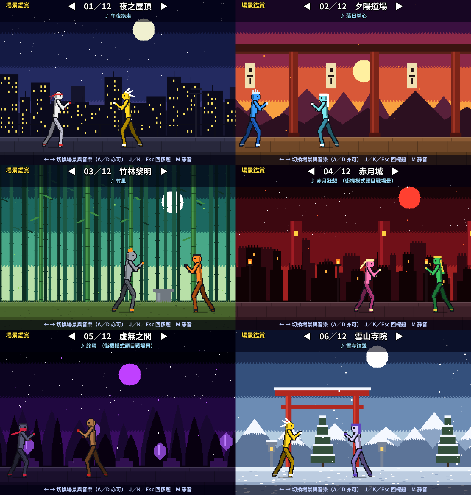
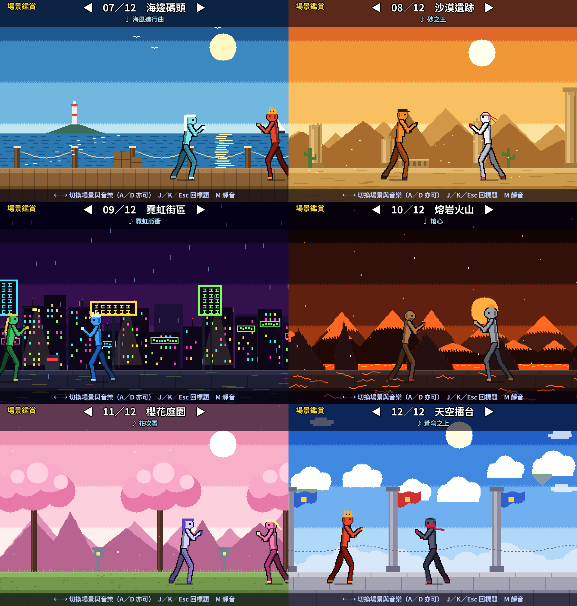
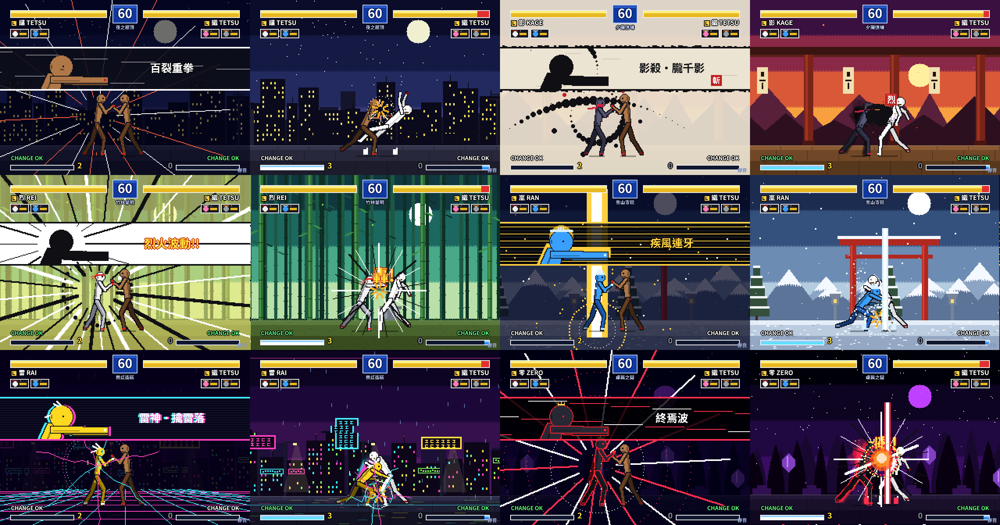
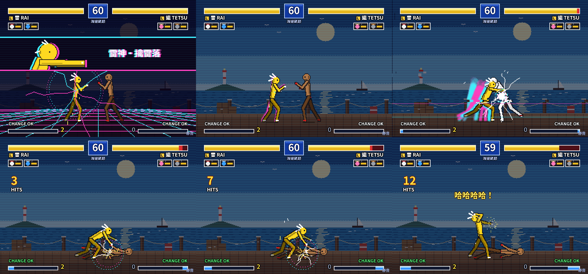

# 火柴鬥魂 3on3（Stick Spirit 3on3）

2D 火柴人 3 對 3 換人制格鬥遊戲，單一 `index.html`，不需安裝、不需建置，用瀏覽器開啟就能玩。

## 怎麼玩

下載或 clone 後，直接用瀏覽器開啟 `index.html`。若把儲存庫設為公開並啟用 GitHub Pages（Settings → Pages → Branch 選 `main`），就可以用網址分享。

## 難度

標題畫面用左右鍵切換：

- **簡單**：給操作不熟的玩家。按住防禦鍵＋輕拳／輕腳／重拳直接出必殺技，＋重腳出超必殺；連打輕拳自動接出連段；站著不動大多會自動防禦；受到電腦的傷害減少。電腦較弱。
- **普通**：標準手感與標準電腦。
- **困難**：電腦判斷精準、積極進攻，會衝刺逼近、連續施壓並用超必殺取消。

## 規則

- 每隊 3 人，選一位隊長；隊長有專屬必殺技。
- 畫面下方亮起 **CHANGE OK** 時可換人，每場比賽每隊限 1 次；場下角色不回血。
- 擊倒對手一人，場上角色回復 1/4 體力。
- 每回合 60 秒；時間到先比剩餘人數，相同再比剩餘體力。
- 連擊 14 下或空中追打 5 次後，對手進入無敵（COMBO LIMIT）。
- 破關街機模式可解鎖 2 名小頭目與大頭目。

## 操作

| | 移動 | 輕拳／輕腳 | 重拳／重腳 | 防禦 | 換人 |
|---|---|---|---|---|---|
| 1P | W A S D | J／K | U／I | H | L、O |
| 2P | 方向鍵 | 數字鍵 1／2 | 數字鍵 4／5 | 數字鍵 0 | 數字鍵 3、6 |

以上是預設按鍵。標題選單的「按鍵設定」可以自訂每一個按鍵（不可重複，選到已使用的按鍵時兩個動作會互換），也可以一鍵套用 2P 無數字鍵盤配置（`;` `'` `P` `[` 攻擊、`,` 防禦、`/` `.` 換人）。設定會存在瀏覽器裡。

- 必殺技：↓→＋拳、↓←＋腳、↓↓＋拳
- 超必殺：↓←＋拳（氣 1 條）
- 隊長專屬必殺：↓→＋腳（氣 2 條）
- 連段：輕 → 重 → 必殺 → 超必殺（必殺技命中後可再輸入超必殺取消）；蹲重拳命中後按住上可空中追打
- 衝刺：快速按兩下「前」（按住持續奔跑）；後撤步：快速按兩下「後」（起跳瞬間無敵）
- Esc 暫停並顯示招式表，M 靜音

## 內容

- 15 名原創角色：12 名一般角色、2 名小頭目、1 名大頭目
- 模式：街機（5 關）、雙人對戰、自由對戰、場景鑑賞、特效風格展示
- 6 種招式特效風格（簡約、水墨、熱血漫畫、元素爆發、霓虹電光、終極華麗），每個角色各有指定風格，可在選單中逐一更改
- 12 張地圖，每張有專屬配樂（WebAudio 即時合成）

### 演出型超必殺

- 炎「紅蓮爆炎拳」：雙手燃火連擊，最後上鉤拳配合大爆炸收尾
- 雷「雷神・擒雷落」：前撲擒拿（無法防禦），壓地持續電擊，大笑後大電擊轟飛
- 影「影殺・朧千影」：一刀斬，命中後化為殘影亂斬，最後影子連擊擊飛

## 調整數值

規則常數集中在 `index.html` 的 `<script>` 開頭：`ROUND_TIME`、`KO_HEAL`、`COMBO_MAX`、`JUG_MAX`、`DMG_SCALE`。
角色資料在 `CH` 陣列，地圖在 `THEMES`，配樂在 `TRACKS`，特效風格在 `STYLES` 與 `hitFX`／`drawFreeze`。
