# 火柴鬥魂 3on3（Stick Spirit 3on3）

2D 火柴人 3 對 3 換人制格鬥遊戲，單一 `index.html`，不需安裝、不需建置，用瀏覽器開啟就能玩。

## 怎麼玩

下載或 clone 後，直接用瀏覽器開啟 `index.html`。若把儲存庫設為公開並啟用 GitHub Pages（Settings → Pages → Branch 選 `main`），就可以用網址分享。

## 線上對戰（不同電腦）

1. 兩台電腦都用瀏覽器開啟遊戲的 **GitHub Pages 網址**（或各自下載 `index.html` 後直接開啟）。在 claude.ai 頁面中無法連線。
2. 一方在主選單選「雙人模式 → 線上對戰（不同電腦）→ 建立房間」，畫面會顯示 6 位數房間碼。
3. 另一方選「加入房間」，用數字鍵輸入房間碼後按 Enter。
4. 雙方各自選 3 名角色與隊長（線上模式開放全部 15 名角色，含小頭目與大頭目），主機決定場景後開打。

技術說明：使用 PeerJS（WebRTC 點對點，含 STUN／TURN 中繼）連線，採格鬥遊戲常用的**回溯式同步（rollback）**：

- 對手按鍵還沒到時先預測並繼續跑，真正按鍵到了若不同就倒回重算，所以網路延遲不會讓畫面停頓。
- 輸入延遲依連線延遲自動調整（2～5 影格），兩邊會自動對齊遊戲進度。
- 每個封包都會補送尚未被確認的按鍵；連線中斷時自動重新連線（最多等 20 秒），畫面會顯示「連線不穩，重新連線中」。
- 線上對戰時雙方固定使用預設特效風格與相同的嗆聲台詞，確保兩邊畫面一致；每秒比對一次狀態，若不一致畫面右下會顯示「同步異常」。
- 部分公司或學校網路會擋 WebRTC，屆時可能無法連線。

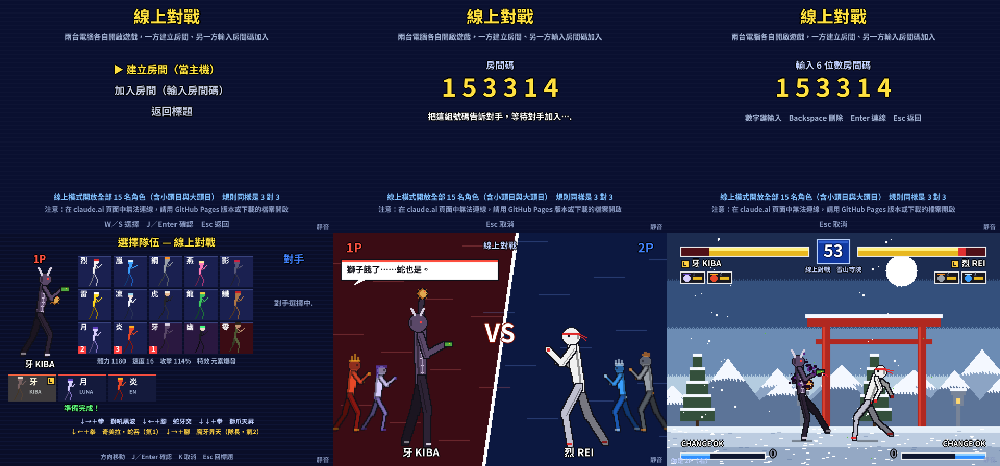

## 難度

標題畫面用左右鍵切換：

- **簡單**：給操作不熟的玩家。按住簡易必殺鍵（預設 1P `H`）＋輕拳／輕腳／重拳直接出必殺技，＋重腳出超必殺；連打輕拳自動接出連段；站著不動大多會自動防禦；受到電腦的傷害減少。電腦較弱。
- **普通**：標準手感與標準電腦。
- **困難**：電腦判斷精準、積極進攻，會衝刺逼近、連續施壓並用超必殺取消。

## 規則

- 每隊 3 人，選一位隊長；隊長有專屬必殺技。
- 畫面下方亮起 **CHANGE OK** 時可換人，每場比賽每隊限 1 次；場下角色不回血。
- 擊倒對手一人，場上角色回復 1/4 體力。
- 每回合 60 秒；時間到先比剩餘人數，相同再比剩餘體力。
- 連擊 14 下或空中追打 5 次後，對手進入無敵（COMBO LIMIT）。
- 街機模式 6 關：一般 3 關 → 小頭目戰（牙、幽兩人，強化版）→ 一般 1 關 → 大頭目戰（零的兩個形態）。破關可解鎖 2 名小頭目與大頭目。

## 操作

| | 移動 | 輕拳／輕腳 | 重拳／重腳 | 簡易必殺（簡單難度） | 換人 |
|---|---|---|---|---|---|
| 1P | W A S D | J／K | U／I | H | L、O |
| 2P | 方向鍵 | 數字鍵 1／2 | 數字鍵 4／5 | 數字鍵 0 | 數字鍵 3、6 |

以上是預設按鍵。「主設定 → 按鍵設定」可以自訂每一個按鍵（不可重複，選到已使用的按鍵時兩個動作會互換），也可以一鍵套用 2P 無數字鍵盤配置（`;` `'` `P` `[` 攻擊、`,` 防禦、`/` `.` 換人）。設定會存在瀏覽器裡。

- 防禦：同格鬥天王，按住「後」站防、按住「後下」蹲防；對手出招逼近時會原地擺出防禦姿勢
- 必殺技：↓→＋拳、↓←＋腳、↓↓＋拳
- 超必殺：↓←＋拳（氣 1 條）
- 強化飛行道具：出飛行道具時同時按兩個拳（或兩個腳），消耗半條氣；道具變大、變快、命中會擊倒，和對手的一般飛行道具相撞時會打穿繼續飛
- 飛行道具相撞會互相抵消（相殺）
- 隊長專屬必殺：↓→＋腳（氣 2 條）
- 連段：輕 → 重 → 必殺 → 超必殺（必殺技命中後可再輸入超必殺取消）；蹲重拳命中後按住上可空中追打
- 衝刺：快速按兩下「前」（按住持續奔跑）；後撤步：快速按兩下「後」（起跳瞬間無敵）
- Esc 暫停並顯示招式表，M 靜音

## 內容

- 15 名原創角色：12 名一般角色、2 名小頭目、1 名大頭目
- 遠距離攻擊：烈「烈焰拳風」、嵐「疾風刃」、虎「虎嘯掌風」、鐵「衝擊拳壓」（↓→＋拳／腳）等，每位角色都有專屬飛行道具或遠距離技
- 主選單：街機模式（6 關）、雙人模式（線上對戰／同一台電腦雙人對戰）、自由對戰、主設定（場景鑑賞、角色特效風格、按鍵設定、操作說明）
- 每場開打前有雙方隊長互相嗆聲的對戰畫面
- 6 種招式特效風格（簡約、水墨、熱血漫畫、元素爆發、霓虹電光、終極華麗），每個角色各有指定風格，可在選單中逐一更改
- 12 張地圖，每張有專屬配樂（WebAudio 即時合成）

### 演出型超必殺

- 炎「紅蓮爆炎拳」：雙手燃火連擊，最後上鉤拳配合大爆炸收尾
- 雷「雷神・擒雷落」：前撲擒拿（無法防禦），壓地持續電擊，大笑後大電擊轟飛
- 影「影殺・朧千影」：一刀斬，命中後化為殘影亂斬，最後影子連擊擊飛

- 烈「炎心爆裂拳」：蓄力右拳突進重擊，命中後火焰沿地面連續炸開，把對手轟上天
- 嵐「暴風連環踢」：高速旋踢捲起龍捲風把對手捲上空，再以落雷般的飛踢收尾
- 龍「蒼龍破山擊」：凝聚龍形氣勁猛衝，雙掌推出巨大的蒼龍衝擊波
- 月「滿月無聲斬」：身影一閃掠過對手，短暫靜止後斬痕接連浮現，最後弦月光刃擊飛
- 燕「燕舞・千羽扇」：雙扇滑行踢，命中後把對手拋上空中，扇子殘影迴轉切割，最後背對展扇打飛
- 凜「絕對零度・碎冰」：前撲擒抱（不可防），把對手凍成冰塊，雙手凝聚大冰彈往下砸，碎冰炸飛
- 鐵「鐵拳・泰之狂襲」：泰拳飛膝，撞到就觸發空中膝肘連擊（一定打滿）
- 虎「猛虎・崩山腿」：一腳踢中後後跳蓄力，再用力踢出，化身猛虎撞飛對手
- 鋼「鋼・十字架炸彈」：衝撞抱起連摔兩次，最後十字架炸彈摔收尾
- 零「血獄・擒滅」：大手抓住對手壓地前衝、再往回衝，最後往上甩，全程血色衝擊波
- 牙「奇美拉・蛇吞」：蛇頭伸長咬人，把對手吞進蛇頭吸血，最後往後甩出
- 幽「幽炎・亂舞葬」：一拳打中後抓住左右甩，每甩一次綠焰爆炸，最後雙手往後拋出大爆炸

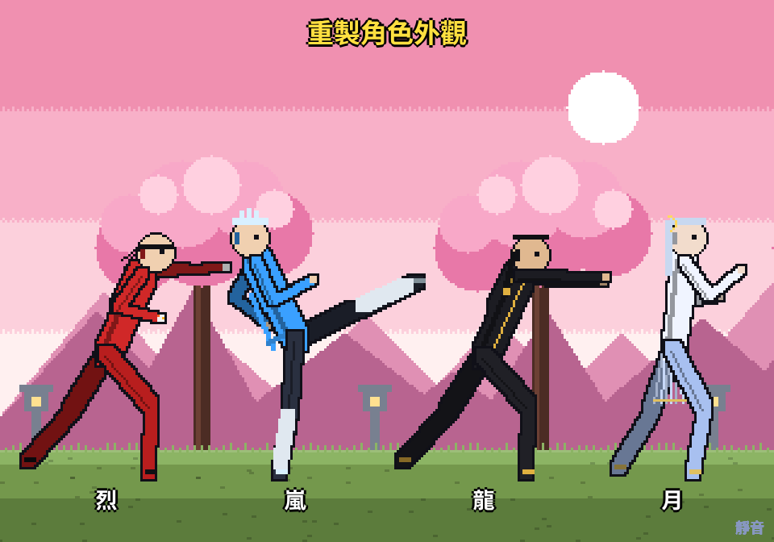
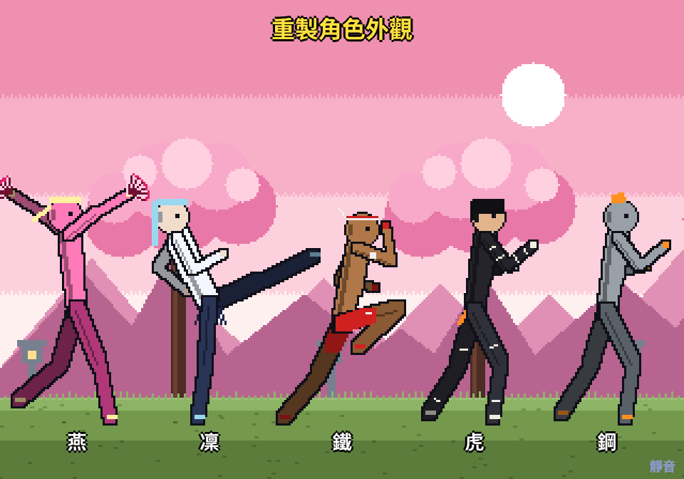
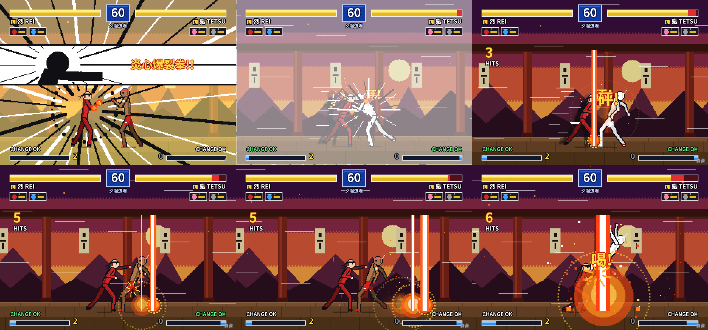
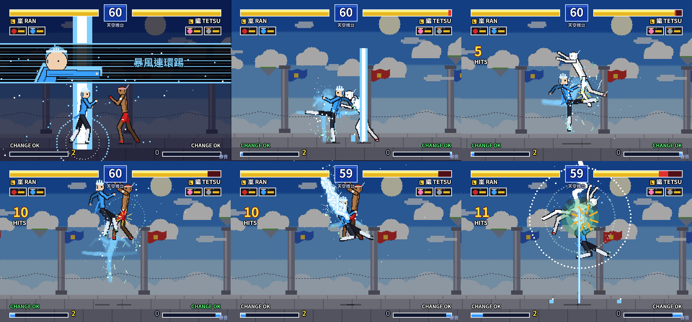
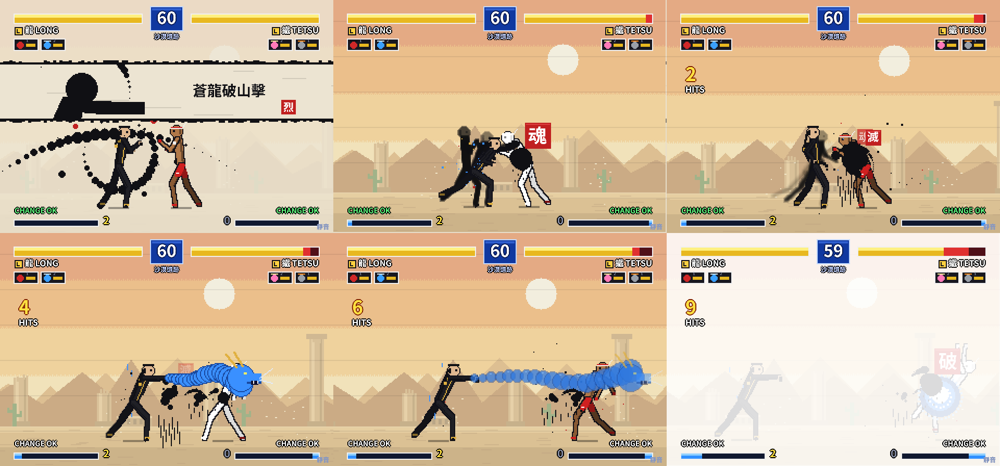
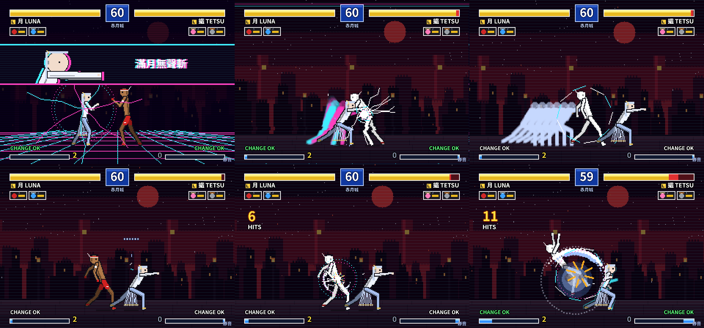
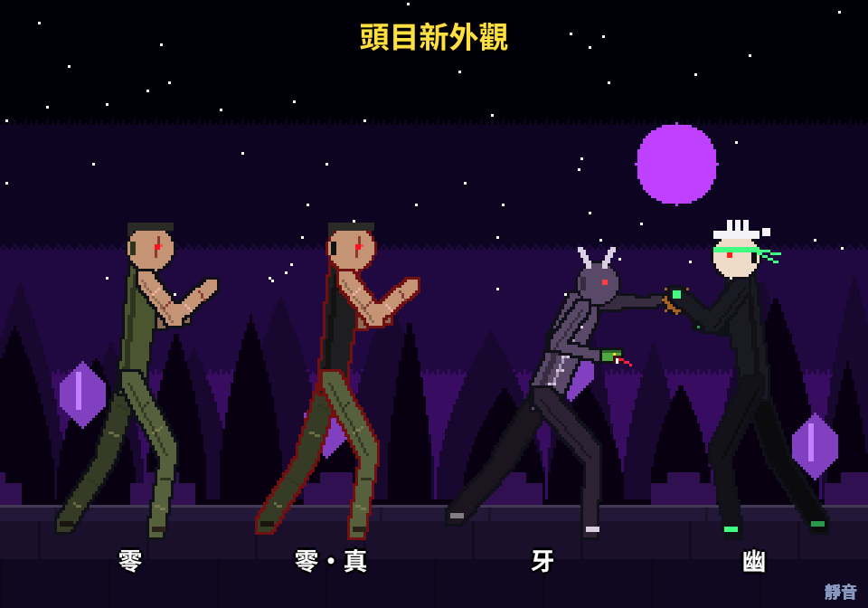
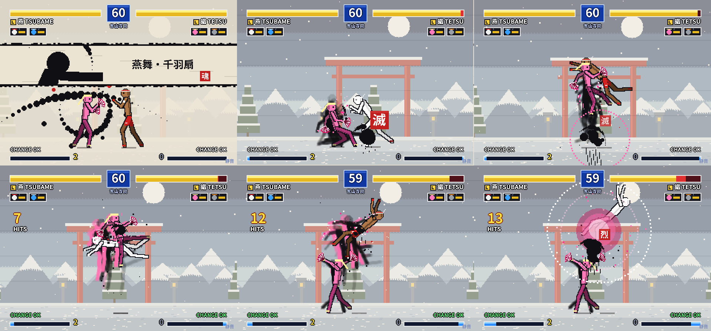
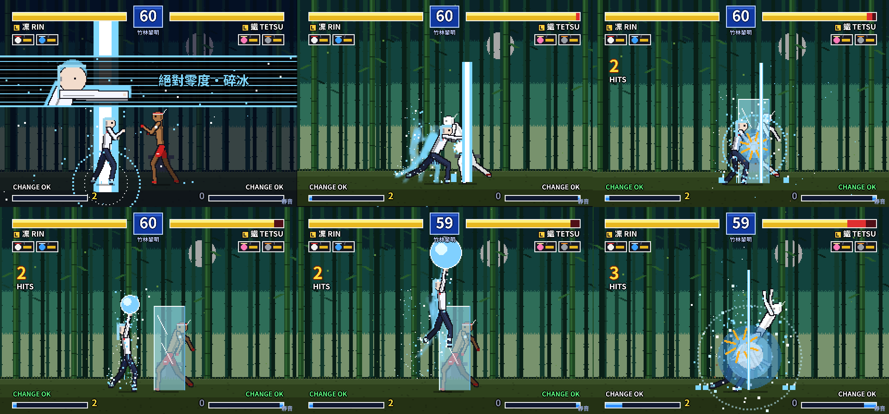
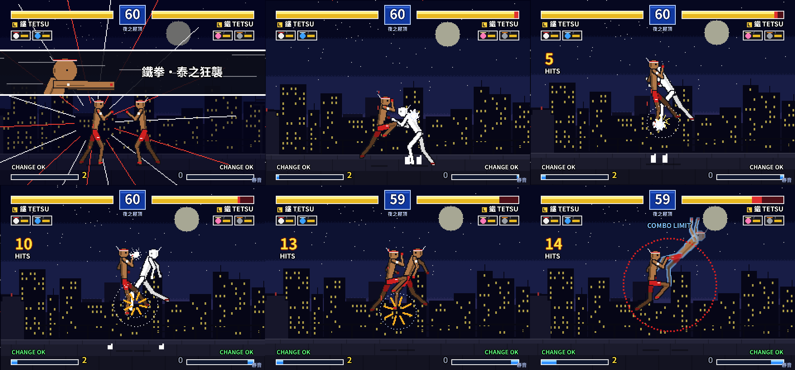
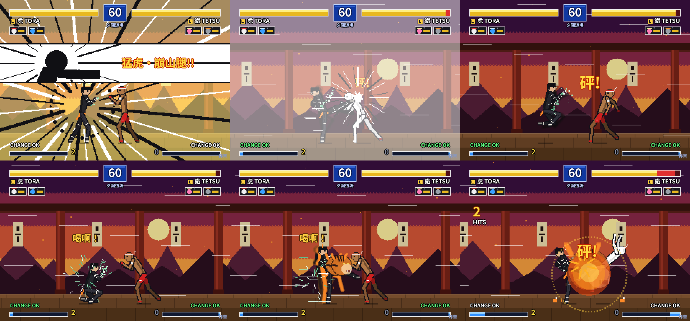
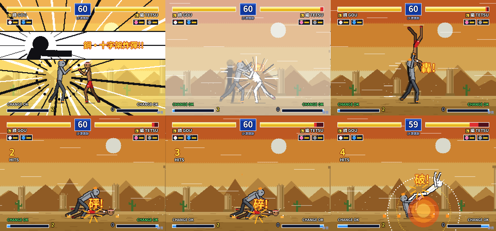
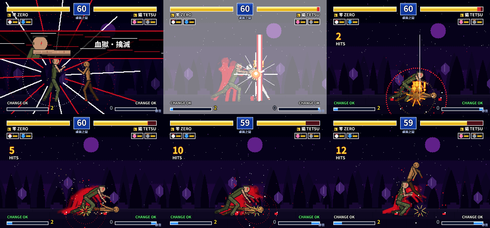
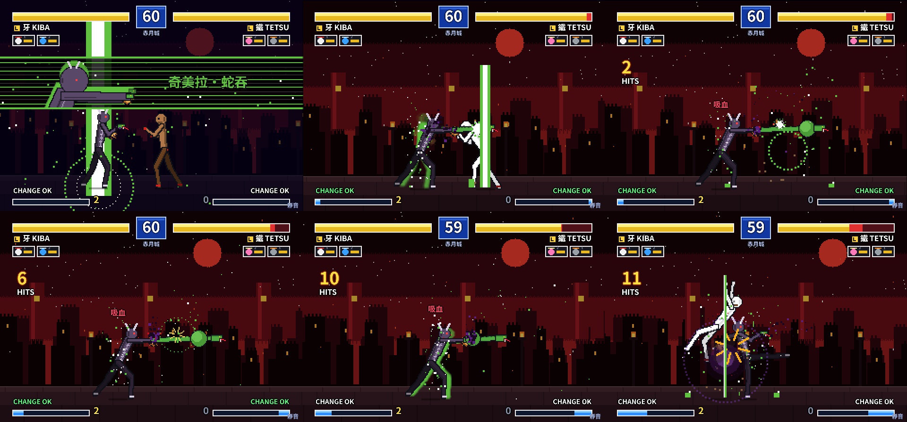
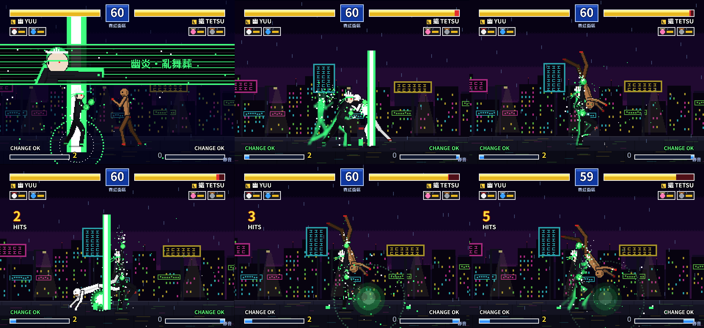
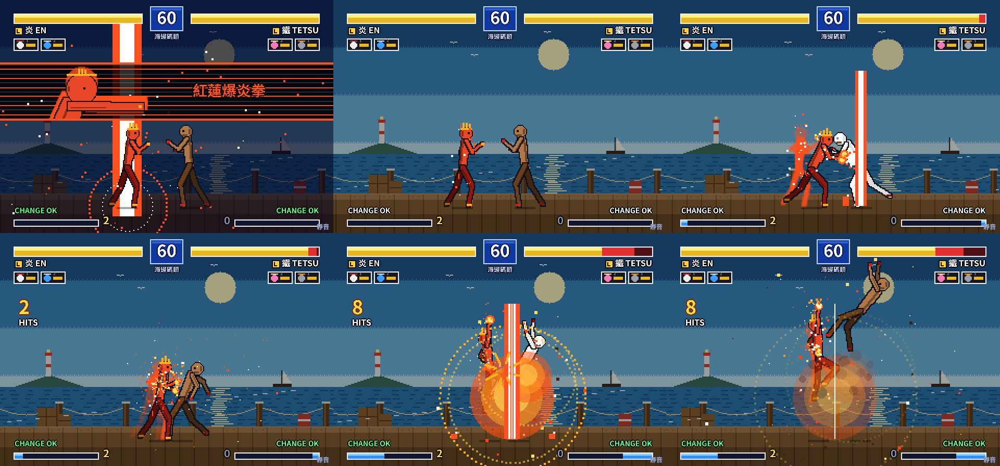

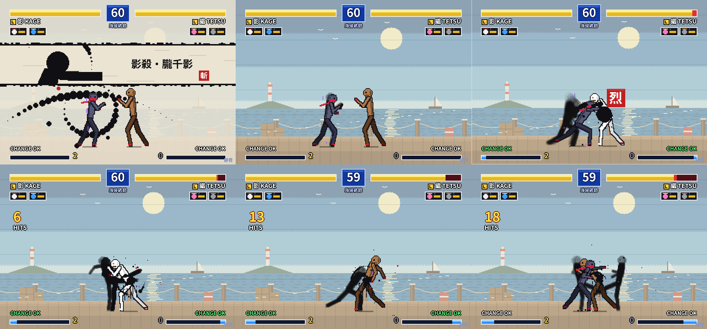

## 調整數值

規則常數集中在 `index.html` 的 `<script>` 開頭：`ROUND_TIME`、`KO_HEAL`、`COMBO_MAX`、`JUG_MAX`、`DMG_SCALE`。
角色資料在 `CH` 陣列，地圖在 `THEMES`，配樂在 `TRACKS`，特效風格在 `STYLES` 與 `hitFX`／`drawFreeze`。
